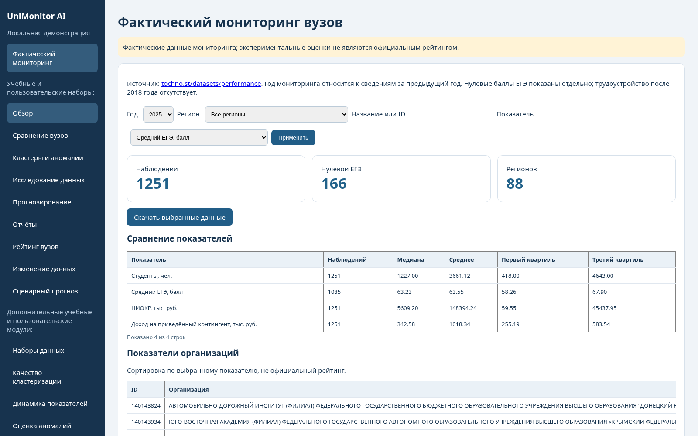

# UniMonitor AI — v1.0 RC11

Система интеллектуального анализа данных мониторинга вузов. Локальное веб-приложение: анализ фактических показателей, нейросетевая диагностика, прогнозирование, поиск и экспорт.



## Запуск (Windows, PowerShell)

```powershell
py -3.13 -m venv .venv
.\.venv\Scripts\python.exe -m pip install -r requirements-local-tested.txt
.\.venv\Scripts\python.exe main.py --init-admin
.\.venv\Scripts\python.exe main.py --port 8080
```

Задайте собственный пароль не короче 12 символов. Откройте http://127.0.0.1:8080. Для Linux/macOS используйте `python3.13` и `.venv/bin/python`. Подробнее: [START_HERE.md](START_HERE.md).

## Состав

| Компонент | Назначение |
|---|---|
| `main.py` | Точка входа |
| `secure_web.py`, `actual_dashboard.py` | Интерфейс и авторизация |
| `prepare_real.py`, `real_data/` | Подготовка и обработанные фактические данные |
| `real_score/`, `actual_score_positive/`, `real_employment/` | Прогнозы, обученные модели, выборки и метрики |
| `actual_anomalies/` | Обученные детекторы и контрольный эксперимент |
| `tests/` | Автоматизированные тесты |
| `*.ipynb` | Вычислительные эксперименты (включая демонстрационные) |
| `actual_screenshots/` | Визуализация HTML-ответов приложения |

## Данные

Источник: К. Губа, Р. Кучаков; обработка «Если быть точным», [Показатели эффективности российских вузов](https://tochno.st/datasets/performance), [CC BY 4.0](https://creativecommons.org/licenses/by/4.0/). Первичный портал: https://monitoring.miccedu.ru/?m=vpo. Включены производные таблицы (13 956 наблюдений из 2 251 127 записей), словарь и описание источника. Исходный CSV-архив доступен у источника и не включён. Для повторной подготовки: `python prepare_real.py <путь-к-архиву-CSV> real_data`. Подробности и ограничения: [START_HERE.md](START_HERE.md).

Учебные наборы `data/demo.csv` и связанные эксперименты отделены от фактических. Трудоустройство доступно лишь до 2018 г.; контрольные аномалии внесены искусственно на основе реальных наблюдений.

## Тестирование

```bash
python -m pytest -q
```

В RC11 пройден 131 тест ([протокол](test_results_v1rc11.txt)). CI настроен для Python 3.13; его запуск в GitHub ещё не подтверждён. Приложение предназначено для локальной эксплуатации. Модели joblib следует загружать только из доверенного источника.

## Документация

- [Начало работы](START_HERE.md)
- [Публикация на GitHub](GITHUB_UPLOAD.md)
- [История разработки](CHANGELOG_AND_DEVELOPMENT.md)
- [Контрольный лист](RELEASE_CHECKLIST.md)
